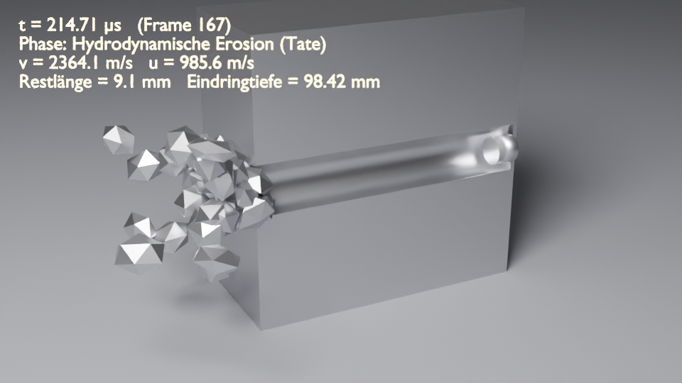

# Blender: Projektil gegen Wolframwürfel

Ein Blender-Add-on (eine einzige Datei: `projektil_wolframwuerfel.py`) für den Einschlag eines Projektils in einen Wolframwürfel.
Es berechnet den Vorgang physikalisch und baut daraus eine animierte Szene:

- Projektil mit Ogivenspitze
- Würfel mit Krater bzw. Schusskanal (Boolean)
- Splitter, Impulsübertrag auf den Würfel
- Kamera, Licht und ein HUD mit Zeit, Geschwindigkeit, Restlänge und Eindringtiefe



## Installation und Bedienung

1. Blender 3.6 oder neuer (getestet mit 5.0) öffnen.
2. *Bearbeiten → Einstellungen → Add-ons → Installieren…* → `projektil_wolframwuerfel.py` wählen und aktivieren.
   Alternativ die Datei im **Text-Editor** öffnen und *Skript ausführen*.
3. Im 3D-Viewport die Seitenleiste mit **N** öffnen → Reiter **Ballistik**.
4. Parameter einstellen → **Simulation berechnen** → Animation mit Leertaste abspielen.

Jeder Klick verwirft die Sammlung „Ballistik“ und baut sie mit den aktuellen Parametern neu auf.

### Kommandozeile

```bash
# Szene headless erzeugen und speichern
blender -b -P blender/projektil_wolframwuerfel.py -- --proj-material WHA --geschwindigkeit 1700 --speichern schuss.blend

# nur die Physik (reines Python, ohne Blender)
python3 blender/projektil_wolframwuerfel.py --proj-material PB --geschwindigkeit 400
```

Jeder Wert aus der Klasse `Parameter` ist als Option verfügbar, z. B. `--proj-laenge 0.15` oder `--wuerfel-frei false`.
Auf der Kommandozeile gelten SI-Einheiten: m, m/s, Pa.

## Einstellbare Parameter

| Gruppe | Parameter |
|---|---|
| Projektil | Werkstoff-Voreinstellung, Dichte, dynamische Fließgrenze Y_p, E-Modul, Querkontraktion, Durchmesser, Länge, Spitzenlänge (Kaliber), Geschwindigkeit, Elevation, Azimut |
| Ziel (Würfel) | Werkstoff-Voreinstellung (Standard: reines Wolfram), Dichte, Fließgrenze Y_t, E-Modul, Querkontraktion, Kantenlänge, Zielwiderstand R_t (automatisch oder manuell), frei gelagert ja/nein, Schnittansicht |
| Flug & Stoß | Startabstand, Gravitation, Luftdichte, c_w-Wert, Stoßzahl e |
| Animation | Frames je Phase (Flug / Einschlag / Nachlauf), fps, Nachlaufzeit, Splitteranzahl, Zufallsstartwert |

Werkstoff-Voreinstellungen: Wolfram, Wolfram-Schwermetall, abgereichertes Uran, Wolframcarbid, Panzerstahl, Baustahl, Kupfer, Messing, Blei, Aluminium 7075.
Nach der Auswahl lassen sich alle Werte einzeln ändern.

## Physikalisches Modell

| Phase | Modell |
|---|---|
| Flug | Newton mit Schwerkraft und quadratischem Luftwiderstand `F = ½·ρ_L·c_w·A·|v|·v`, RK4-Integration |
| Aufprallkriterium | Kontaktspannung der ebenen Stoßwelle `σ = v·Z_p·Z_t/(Z_p+Z_t)`, `Z = √(E·ρ)`. Liegt σ unter beiden Fließgrenzen, ist der Stoß elastisch. |
| Elastischer Stoß | Masse-Feder-Modell: axiale Stabsteifigkeit `E_p·A/L` in Reihe mit dem Boussinesq-Flachstempel `k = 2·R·E*`. Daraus folgen Kontaktzeit und Annäherung; der Rückprall ergibt sich aus der Stoßzahl e und der Impulserhaltung. |
| Eindringen | **Tate-Alekseevskii**: `½ρ_p(v−u)² + Y_p = ½ρ_t u² + R_t`, `dv/dt = −Y_p/(ρ_p L)`, `dL/dt = −(v−u)`, `dP/dt = u`. Integration mit RK2 (Mittelpunktsverfahren). Enthält die Grenzfälle *starres Eindringen* (u = v) und *Oberflächenerosion ohne Penetration* (u = 0, z. B. Blei auf Wolfram). |
| Zielwiderstand | nach Tate: `R_t = Y_t·(2/3 + ln(0,57·E_t/Y_t))`, für reines Wolfram ≈ 8,6 GPa |
| Kraterdurchmesser | Kavitätenexpansion: `D_k = D_p·√(1 + ρ_p(v−u)²/(2R_t))`; der Wert gilt jeweils für die momentane Tiefe |
| Impuls | Der Würfel übernimmt, was Restprojektil und Splitter nicht forttragen (Impulserhaltung exakt). Die Energiebilanz weist die dissipierte Energie aus. |

Die Ergebnisse stehen im Panel **Ergebnisse** und im HUD.
Angezeigt werden unter anderem Masse, Aufprallenergie, Regime, Eindringgeschwindigkeit u, Eindringtiefe mit P/L, Kraterdurchmesser, Eindringdauer, Restmasse und Restgeschwindigkeit, Würfelgeschwindigkeit und dissipierte Energie.

Ausgang der Simulation: *Steckschuss*, *Durchschuss*, *Projektil vollständig aufgezehrt*, *Projektil an der Oberfläche gestaucht*, *Abpraller* oder *Verfehlt*.

### Grenzen des Modells

Das Tate-Modell ist ein eindimensionales, halbempirisches Standardmodell der Endballistik und keine Finite-Elemente-/Hydrocode-Simulation. Daraus folgen diese Vereinfachungen:

- Der Eindringvorgang läuft entlang der Flugrichtung, Schrägauftreffen wird nicht gesondert behandelt.
- Das Ziel gilt als Halbraum, Randeffekte an der Rückseite (Ausbeulen, Pfropfen) fehlen.
- Die Werkstoffe sind ideal plastisch; Dehnrate, Temperatur und Sprödbruch werden nicht berücksichtigt.
- Richtung und Geschwindigkeit der Splitter sind eine visuelle Näherung. Sie orientiert sich an der Rückströmung `2u − v` des erodierten Materials und bleibt impulserhaltend.
- Die Fließgrenzen der Voreinstellungen sind typische dynamische Werte. Für genauere Ergebnisse die Daten des konkreten Werkstoffs eintragen.
- Die Zeitachse ist abschnittsweise gedehnt: Der Einschlag dauert nur Mikrosekunden. Das HUD zeigt die physikalische Zeit.

## Tests

```bash
python3 -m unittest discover -s blender/tests
```

Die Tests prüfen unter anderem:

- Bernoulli-Bilanz, hydrodynamischer Grenzfall und Regimewechsel
- Geometrie (Volumen)
- freien Fall ohne Luftwiderstand
- Impulserhaltung in allen Einschlagsfällen
- Stoßzahl und monoton steigende Eindringtiefe mit der Geschwindigkeit
